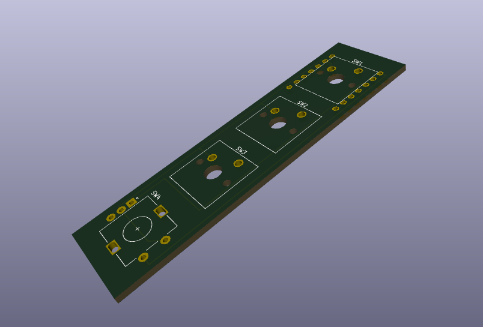
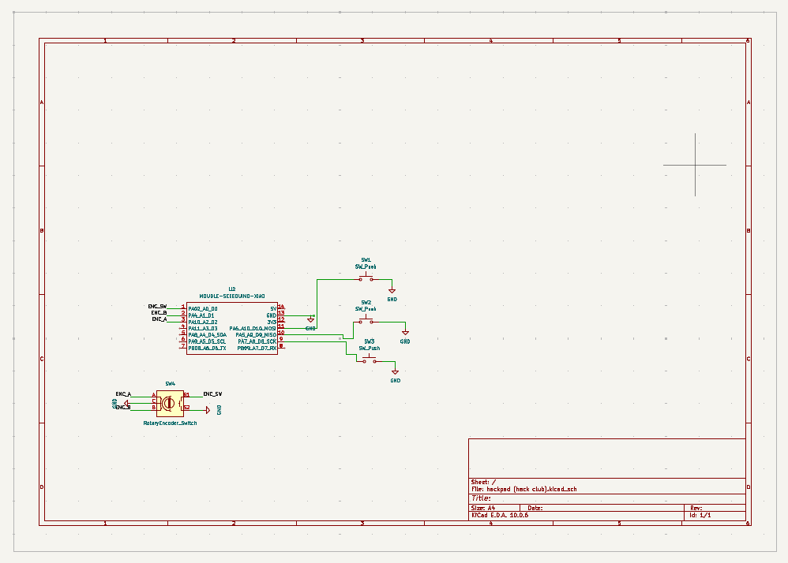
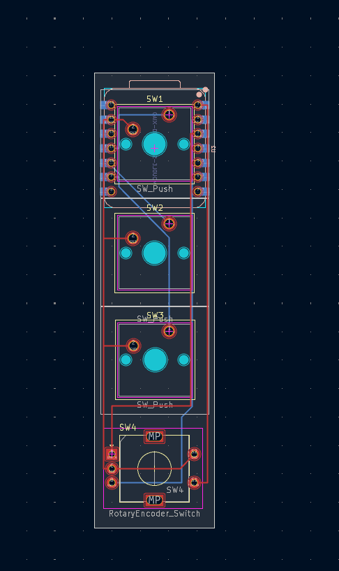
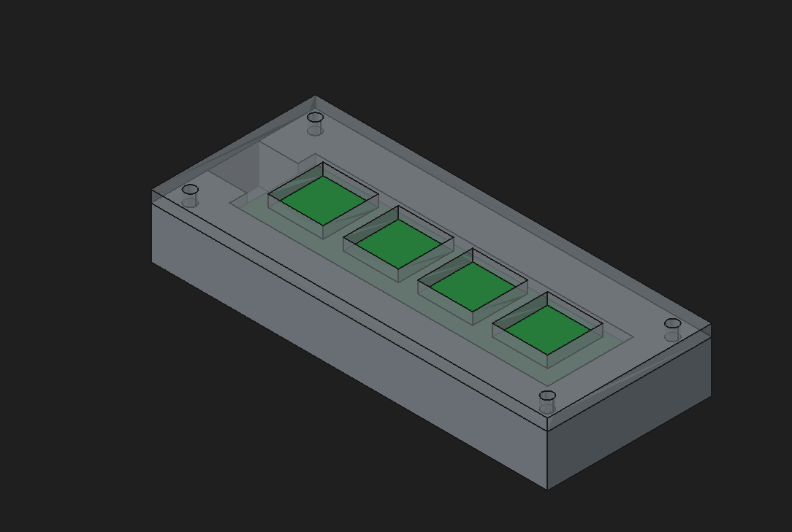

# Hackpad: 3 keys + a volume knob

A small macropad built for Hack Club's [Hackpad](https://hackpad.hackclub.com) program. It has three mechanical keys for copy, paste and undo, plus a rotary encoder knob that controls volume (turn) and mute (press). It runs custom QMK firmware on a Seeed XIAO RP2040.



## Features
- 3 × MX-style keys: Cmd+C, Cmd+V, Cmd+Z (easy to remap in `Firmware/hackpad/keymaps/default/keymap.c`)
- 1 × EC11 rotary encoder: volume down/up, press to mute
- Direct-pin wiring, so no diodes are needed
- 2-layer PCB, 21 × 80 mm
- 3D-printed sandwich-mount case (bottom + top plate), 100.85 × 41.8 × 16 mm

## Schematic


## PCB


The XIAO is mounted on the back of the board, behind SW1, following the Hackpad guide.

| Part | XIAO pin | RP2040 GPIO |
|---|---|---|
| SW1 (top key) | 11 (D10) | GP3 |
| SW2 | 10 (D9) | GP4 |
| SW3 | 9 (D8) | GP2 |
| Encoder A | 3 (D2) | GP28 |
| Encoder B | 2 (D1) | GP27 |
| Encoder push | 1 (D0) | GP26 |
| GND (all switches, encoder C & S2) | 13 | GND |

## Case


The case has two printed parts that sandwich the PCB:
- **Bottom**: 13 mm tall tray with a 3 mm floor, a pocket for the PCB (0.4 mm clearance per side) and a USB-C cutout at the XIAO end.
- **Top**: 3 mm plate with 14 × 14 mm openings for the three switches and the knob.

Four M3 screws go through the corners to hold the two parts together.

## Firmware
QMK firmware lives in `Firmware/hackpad`. To build it:

```
qmk compile -kb hackpad -km default
```

To flash it, hold the XIAO's BOOT button while plugging it in, then drag `production/firmware.uf2` onto the `RPI-RP2` drive.

## Bill of materials (BOM)

| Qty | Part | Notes |
|---|---|---|
| 1 | Seeed Studio XIAO RP2040 | Through-hole, mounted on the back of the PCB |
| 3 | MX-style mechanical switches | |
| 3 | 1u keycaps | |
| 1 | EC11 rotary encoder with push switch | Alps EC11E footprint |
| 1 | Knob for the EC11 encoder | |
| 4 | M3 × 16 mm screws | Hold the plate to the bottom |
| 1 | PCB | 2 layers, 21 × 80 mm (`production/gerbers.zip`) |
| 1 | 3D-printed bottom | `production/Bottom.STEP` |
| 1 | 3D-printed top plate | `production/Top.STEP` |

## Repository layout
```
CAD/          full assembled model (hackpad.STEP) + FreeCAD source
PCB/          KiCad project (.kicad_pro, .kicad_sch, .kicad_pcb)
Firmware/     QMK source
production/   gerbers.zip, Top/Bottom.STEP, firmware.uf2
images/       screenshots for this README
```
